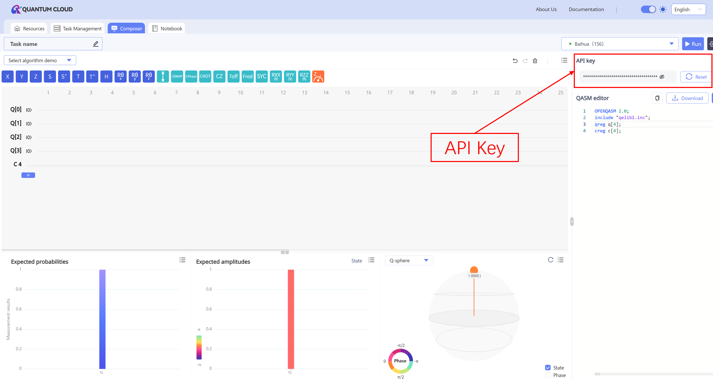

## 1. Introduction

`gjq-client` is the Python client for the Guoji Quantum Cloud Platform. It provides efficient and convenient tools for building and transpiling quantum circuits, submitting jobs, and retrieving results. Whether you are new to quantum computing or engaged in scientific research and engineering, `gjq-client` enables quick access to cloud quantum resources for designing, validating, and experimenting with quantum algorithms.
In addition to Qiskit workflows, `gjq-client 0.2.1` provides exclusive-resource execution through Sessions, thousand-qubit MPS simulation, optional PennyLane integration, and post-quantum cryptography (PQC) communication through the PQC Gateway. This guide covers installation and authentication, backend selection, circuit transpilation, Sampler and Estimator, MPS, Sessions, PennyLane, the PQC encrypted channel, and job queries.
The platform and `gjq-client` provide access to the following computing resources. Backend availability, queue lengths, and supported job modes may change; always refer to the real-time output of `service.list_backends()`:

- Full-amplitude simulators: Jiuxiao `FAS-CPU` (20) and Qilv `FAS-GPU` (32)

- Single-amplitude simulators: Jiuyuan `SAS-CPU` (200) and Qiyao `SAS-GPU` (32)

- Tensor-network simulator: Qiyi `MPS` (1000)

- Quantum hardware: Baihua `Baihua` (156) and Guoji No. 8 `Guoji08` (20)

## 2. Installation and authentication

### 2.1 Installation

`gjq-client 0.2.1` requires Python 3.12 or later and uses Qiskit 2.3. We recommend creating an isolated virtual environment to avoid conflicts between project dependencies and other packages installed in the system Python environment:

```powershell
python -m venv .venv
.\.venv\Scripts\Activate.ps1
python -m pip install --upgrade pip
python -m pip install gjq-client
```

The base installation automatically installs `requests`, Qiskit, `qiskit-ibm-runtime`, and the `cryptography` package required for PQC communication. To use PennyLane, install the optional dependency:

```powershell
python -m pip install "gjq-client[pennylane]"
```

The GitHub repository provides the public SDK source for reference. Use the PyPI distribution to run the SDK: it includes the compiled connection components required for cloud access. This source checkout does not support standalone installation or execution.

### 2.2 API Key and account cache

Sign in to the [Guoji Quantum Cloud Platform](https://tiangongqs.com/cloud/circuit) to obtain an API Key:



We recommend passing the key through an environment variable instead of embedding it in source code:

```powershell
$env:GJQ_API_KEY = "your_api_key"
```

```python
import os
from gjq_client import GJQRuntimeService

# Read the API Key from the environment on the first run. After successful initialization, the account configuration is cached locally.
service = GJQRuntimeService(api_key=os.environ["GJQ_API_KEY"])

# list_backends() prints a backend table and returns a list of backend information dictionaries.
backends = service.list_backends()
```

Subsequent runs can reuse the cached local account configuration:

```python
from gjq_client import GJQRuntimeService

service = GJQRuntimeService()
```

After an API Key is provided for the first time, the SDK writes the account parameters to:

- Windows: `%USERPROFILE%\.gjq_client\gjq_client_account.json`

- Linux/macOS: `~/.gjq_client/gjq_client_account.json`

**Security recommendations:**

- Never upload a configuration file containing an `api_key` to a public source-code repository.

- For CLI or automated environments, create an API Key limited to the required permissions and rotate it periodically as needed.

## 3. Backend discovery and status

`list_backends()` prints and returns the currently available backends. Common fields in each returned item include `name`, `type`, `max_qubits`, `available_qubits`, `num_of_pending_tasks`, and `job_mode`. `job_mode` supports Job mode for conventional standalone jobs and Session mode for session-based execution.

```python
from gjq_client import GJQRuntimeService

# This snippet is for querying only and is not recommended for production code.
service = GJQRuntimeService()  # The initial account configuration has been completed.
available = service.list_backends() # Prints a backend table like the one below.

# Example output; always rely on the real-time result:
# Available backends (7):
# Name    | Type            | Max qubits | Available qubits | Pending tasks | Job modes   
# --------+-----------------+------------+------------------+---------------+-------------
# FAS-CPU | CPU Simulator   | 20         | 20               | 51            | job         
# SAS-CPU | CPU Simulator   | 200        | 200              | 2             | job         
# FAS-GPU | GPU Simulator   | 32         | 32               | 5             | job         
# SAS-GPU | GPU Simulator   | 32         | 32               | 1             | job         
# Baihua  | Superconducting | 156        | 154              | 0             | job         
# Guoji08 | Superconducting | 20         | 20               | 152           | job, session
# MPS     | GPU Simulator   | 1000       | 1000             | 50            | job       

backend = service.backend("Baihua")

# basis_gates shows the native gate set; coupling_map shows two-qubit gate connectivity constraints.
print(backend.configuration().basis_gates)
print(backend.configuration().coupling_map)
```

Notes:

- `service.backend(name)` accepts only the name of a currently available backend.

- `service.least_busy()` selects the backend with the shortest queue from all available backends. The result may be a simulator and is not guaranteed to be quantum hardware.

- `configuration().coupling_map` combines the top-level configuration with the connectivity constraints of individual quantum gates.

- Quantum-hardware properties come from the remote calibration service. Some devices, such as simulators, may not currently provide frequency or gate-error data.

## 4. Building and transpiling circuits

We recommend always transpiling a circuit for its target backend. `optimization_level` supports `0`, `1`, `2`, and `3`, with a default value of `2`; higher values generally apply more aggressive optimization. `None` returns an empty PassManager and does not transform the circuit to the target backend's gate set. Use it only when the original circuit already satisfies all backend constraints.

```python
from qiskit import QuantumCircuit
from gjq_client import GJQRuntimeService, generate_preset_pass_manager

service = GJQRuntimeService()
backend = service.backend("FAS-CPU")

# Create a Bell state; in theory, the measurement results are concentrated on 00 and 11.
circuit = QuantumCircuit(2)
circuit.h(0)
circuit.cx(0, 1)
circuit.measure_all()

# optimization_level=2 balances compilation time and circuit optimization.
# Optionally set seed_transpiler for more reproducible transpilation results.
pass_manager = generate_preset_pass_manager(
    backend=backend,
    optimization_level=2,
    seed_transpiler=42,
)
isa_circuit = pass_manager.run(circuit)

print("Circuit depth before transpilation:", circuit.depth())
print("Circuit depth after transpilation:", isa_circuit.depth())
```

Custom-gate handling rules:

- Native gates declared by the backend are preserved.

- Custom gates with definitions are recursively decomposed before submission, without modifying the original circuit.

- Opaque gates that have no definition and are not native backend operations are rejected before submission.

## 5. Submitting jobs

### 5.1 Sampler

Sampler returns measurement counts. The input circuit must contain at least one `measure` operation.

```python
from qiskit import QuantumCircuit
from gjq_client import GJQRuntimeService, Sampler, generate_preset_pass_manager

service = GJQRuntimeService()
backend = service.backend("FAS-CPU")

# Build a two-qubit Bell state and measure all qubits.
circuit = QuantumCircuit(2)
circuit.h(0)
circuit.cx(0, 1)
circuit.measure_all()

# Transpile for the target backend's gate set and connectivity before submission.
isa_circuit = generate_preset_pass_manager(
    backend=backend,
    optimization_level=2,
).run(circuit)

# shots is the number of repeated samples; more shots generally produce a more stable distribution.
job = Sampler(backend=backend).run(isa_circuit, shots=1024)

# result() polls the job status; timeout limits only the client-side wait time.
result = job.result(timeout=300)
counts = result["counts"]
print("Measurement counts:", counts)
print("Actual total samples:", sum(counts.values()))
```

The keys in `counts` are classical bitstrings, and each value is the number of times that result occurred. Their sum normally equals `shots`. `RuntimeJob.result()` waits until the job reaches a terminal state. Quantum-hardware jobs may require time for queuing and result persistence; the SDK polls automatically, so you do not need to write a polling loop.

#### SAS single-amplitude backends

Every `SAS-CPU` and `SAS-GPU` job must provide exactly one valid `amplitude_index` in the range `0 <= index < 2**n_qubits`.

```python
backend = service.backend("SAS-CPU")
isa_circuit = generate_preset_pass_manager(backend=backend).run(circuit)
job = Sampler(backend=backend).run(
    isa_circuit,
    shots=1024,
    amplitude_index=[0],  # Query the single amplitude of the |00...0> computational basis state.
)
result = job.result(timeout=300)
```

SAS returns the single amplitude of the specified computational basis state. Do not treat it as a complete distribution for calculating general expectation values.

### 5.2 Estimator

Estimator calculates expectation values of observables for a quantum state. The following example runs on Guoji No. 8, `Guoji08`. Its high-level `Estimator.run()` accepts unmeasured or partially measured input circuits and automatically normalizes terminal measurement coverage without modifying the caller's circuit.

```python
from qiskit import QuantumCircuit
from qiskit.quantum_info import SparsePauliOp
from gjq_client import Estimator, generate_preset_pass_manager

backend = service.backend("Guoji08")
circuit = QuantumCircuit(1)
circuit.h(0)

observable = SparsePauliOp("X")
isa_circuit = generate_preset_pass_manager(backend=backend).run(circuit)

result = Estimator(backend=backend).run(
    isa_circuit,
    observable=observable,
    shots=1024,
).result(timeout=300)
print(result["evs"])
```

When you use string-form observables, qubit indices are interpreted as physical qubits of the submitted circuit and no logical-layout mapping is applied. Use `SparsePauliOp` if automatic logical-layout mapping is required.

Guoji08 supports finite real coefficients, multi-qubit X/Y/Z Pauli words, identity terms, and named Hamiltonian sums. A multi-term `SparsePauliOp` returns one aggregate expectation under `result["evs"]["observable"]`; an explicit named observable list returns an independent value for each supplied name. Guoji08 requires positive integer `shots`; `shots=0` is available only for MPS Estimator.

### 5.3 MPS simulator

MPS supports between 2 and 1,000 qubits, but the practical runnable scale depends on circuit depth and entanglement. Every job must provide `options["simulator_config"]`.

#### 5.3.1 Presets and configuration parameters

`fast`, `balanced`, and `accurate` are built-in presets. With these presets, you can select only the preset name and GPU count; you cannot also override `dtype`, `mps`, or `svd`. Use `expert` when these parameters must be customized.

| Preset | Data type | Maximum bond dimension | Truncation parameters | SVD | Use case |
| --- | --- | ---: | --- | --- | --- |
| `fast` | `complex64` | 64 | `abs=1e-8`, `rel=1e-8`, `discarded=1e-10` | `gesvd` | Prioritize speed and lower GPU-memory use |
| `balanced` | `complex128` | 128 | `abs=1e-10`, `rel=1e-10`, `discarded=1e-12` | `gesvd` | Balance speed and accuracy |
| `accurate` | `complex128` | 512 | `abs=1e-12`, `rel=1e-12`, `discarded=1e-14` | `gesvdj`, tolerance `1e-12`, up to 80 sweeps | Prioritize accuracy |
| `expert` | User-defined | User-defined | User-defined | User-defined | Explicit control over numerical parameters |

A simple preset configuration must contain only `preset` and `runtime`:

```python
options = {
    "simulator_config": {
        "preset": "fast",  # balanced and accurate are also available
        "runtime": {"num_gpus": 1},
    }
}
```

`expert` requires all of the following fields. No field may be omitted, and no undefined field may be added:

| Parameter | Allowed value or range | Description |
| --- | --- | --- |
| `dtype` | `complex64`, `complex128` | Data precision of the state tensor |
| `runtime.num_gpus` | Integer from 1 to 2 | Number of GPUs used |
| `mps.max_bond_dimension` | Integer from 2 to 4096 | Maximum MPS bond dimension; larger values generally improve accuracy but consume more resources |
| `mps.abs_cutoff` | `1e-18` to `1e-2` | Absolute singular-value truncation threshold |
| `mps.rel_cutoff` | `1e-18` to `1e-2` | Relative singular-value truncation threshold |
| `mps.discarded_weight_cutoff` | `1e-18` to `1e-4` | Discarded-weight threshold |
| `svd.algorithm` | `gesvd`, `gesvdp`, `gesvdj` | SVD algorithm |
| `svd.gesvdj_tol` | `0`, or `1e-18` to `1e-2` | Used only with `gesvdj` and required for that algorithm |
| `svd.gesvdj_max_sweeps` | Integer from 1 to 200 | Used only with `gesvdj` and required for that algorithm |

Complete `expert` example:

```python
expert_options = {
    "simulator_config": {
        "preset": "expert",
        "dtype": "complex128",
        "mps": {
            "max_bond_dimension": 256,
            "abs_cutoff": 1e-10,
            "rel_cutoff": 1e-10,
            "discarded_weight_cutoff": 1e-12,
        },
        "svd": {
            "algorithm": "gesvdj",
            "gesvdj_tol": 1e-12,
            "gesvdj_max_sweeps": 80,
        },
        "runtime": {"num_gpus": 1},
    }
}
```

When selecting `gesvd` or `gesvdp`, `svd` may contain only `algorithm`. `gesvdj_tol` and `gesvdj_max_sweeps` can be used only with `gesvdj`.

#### 5.3.2 Sampler example: retrieving a sampling distribution

The first example below uses MPS Sampler, and its circuit must include measurement gates. `counts` is a stable return field. When the server returns a probability-based result and the SDK reconstructs integer shots from it, the optional `probabilities` field is also preserved. That field may be absent when the server directly returns integer counts.

```python
from qiskit import QuantumCircuit
from gjq_client import GJQRuntimeService, Sampler

service = GJQRuntimeService()
backend = service.backend("MPS")

circuit = QuantumCircuit(10)
circuit.h(0)
# Build a 10-qubit GHZ state using adjacent CNOT gates.
for qubit in range(9):
    circuit.cx(qubit, qubit + 1)
circuit.measure_all()

options = {
    "simulator_config": {
        "preset": "fast",            # Prioritize speed and lower GPU-memory use.
        "runtime": {"num_gpus": 1}, # Use one GPU for this job.
    }
}

result = Sampler(backend=backend, options=options).run(
    circuit,
    shots=1024,
).result(timeout=300)
print("Sampling counts:", result["counts"])
```

#### 5.3.3 Estimator example: retrieving an expectation value

MPS Sampler requires positive `shots`. MPS Estimator accepts `shots=0`; PennyLane QNodes still require positive finite shots.

The second example uses MPS Estimator. It calculates an expectation value directly from the simulated state and does not require measurement gates; `backend` and `options` are reused from the preceding example. MPS Estimator supports finite real coefficients, multi-qubit Pauli words, identity terms, and Hamiltonian sums. A multi-term `SparsePauliOp` returns one aggregate value under the `observable` result name.

```python
from qiskit import QuantumCircuit
from qiskit.quantum_info import SparsePauliOp
from gjq_client import Estimator

bell = QuantumCircuit(2)
bell.h(0)
bell.cx(0, 1)

# MPS Estimator calculates the expectation value directly from the simulated state, so no measurement gate is required.
hamiltonian = SparsePauliOp.from_list([("ZZ", 0.5), ("XI", 0.8)])
result = Estimator(backend=backend, options=options).run(
    bell,
    observable=hamiltonian,
    shots=0,           # State simulation does not use finite-shot sampling.
).result(timeout=300)
print("Hamiltonian:", result["evs"]["observable"])
```

## 6. Session

A Session can be created only on a backend whose `job_mode` contains `session`. Currently, only `Guoji08` supports both `job` and `session`; always rely on the real-time result. The valid range of `max_time` is 60 to 28,800 seconds.
A Session is designed for running multiple related jobs in succession. During its lifetime, those jobs share the same `session_id` and reuse the same exclusive backend resource instead of requesting resources separately for every job. The following example submits two circuits consecutively within one Session and then queries the Session status and associated jobs.

```python
from qiskit import QuantumCircuit
from gjq_client import GJQRuntimeService, Sampler, Session, generate_preset_pass_manager

service = GJQRuntimeService()
backend = service.backend("Guoji08")

bell = QuantumCircuit(2)
bell.h(0)
bell.cx(0, 1)
bell.measure_all()

inverted_bell = QuantumCircuit(2)
inverted_bell.x(0)
inverted_bell.h(0)
inverted_bell.cx(0, 1)
inverted_bell.measure_all()

pass_manager = generate_preset_pass_manager(backend=backend)
isa_circuits = [pass_manager.run(circuit) for circuit in (bell, inverted_bell)]

# Both jobs share the same Session and backend resource.
with Session(backend=backend, max_time=3600) as session:
    print(f"Session created successfully. Session ID: {session.session_id}")
    sampler = Sampler(mode=session)
    jobs = [sampler.run(circuit, shots=256) for circuit in isa_circuits]

    for index, job in enumerate(jobs, start=1):
        print(f"Job {index} counts:", job.result(timeout=600)["counts"])

    print(f"Session {session.session_id} status:", session.status)
    print(f"Jobs in Session {session.session_id}:", session.tasks())
```

Both job payloads carry the same `session_id`. Exiting the `with` block automatically closes the Session and releases its resources. A backend that does not support Sessions rejects the request during Session creation.

Creating a Session directly with `session = Session(...)` keeps it available across subsequent code until `close()`, `cancel()`, or `max_time` expiry. Save both its `session_id` and backend name to query it later.

## 7. Querying jobs

### 7.1 Querying individual jobs

```python
from gjq_client import GJQRuntimeService
from qiskit.quantum_info import SparsePauliOp

service = GJQRuntimeService()
# Retrieve all active jobs for the current user.
tasks = service.list_tasks()
print("All active jobs for the current user:", tasks)

# Replace your_task_id to retrieve the status of a specific job.
task_id = "your_task_id"
status = service.task_status(task_id)
print(f"Status of job {task_id}: {status}") 

# Sampler: query counts.
counts = service.task_result(task_id)
print(f"Sampling counts for job {task_id}: {counts}")

# Estimator: query an observable.
observable = SparsePauliOp("IZ")
evs = service.task_result(task_id, observable=observable)
print(f"Expectation value for job {task_id}: {evs}")
```

`service.task_status()` returns a status string rather than a dictionary containing `status`. `service.task_result()` returns simplified counts or evs. To retain complete response metadata, keep the `RuntimeJob` returned when the job is submitted and call `job.result()`.

### 7.2 Querying Sessions and their jobs

Use the saved Session ID and backend name to retrieve details and related jobs:

```python
from gjq_client import GJQRuntimeService

service = GJQRuntimeService()
session_id = "your_session_id"
backend_name = "Guoji08"

print("Pending and active Sessions:", service.list_sessions())
print("Session details:", service.session_detail(session_id, backend_name))
print("Session jobs:", service.session_tasks(session_id, backend_name))
```

These queries do not create a Session or change its state. `list_sessions()` includes only `pending` and `active` Sessions. For a closed or cancelled Session, use its saved backend name with `session_detail()` or `session_tasks()` directly.

## 8. PennyLane integration

PennyLane is suitable for parameterized quantum circuits, automatic differentiation, and variational algorithms. Before use, install the optional dependency with `pip install "gjq-client[pennylane]"`. The following example creates a `gjq` device on an available FAS backend or quantum-hardware backend and calculates a gradient with the parameter-shift method:

```python
import pennylane as qml
from pennylane import numpy as np
from gjq_client import GJQRuntimeService

service = GJQRuntimeService()
backend = service.backend("FAS-CPU")

# wires specifies the number of qubits available to the QNode; timeout is the maximum wait for one cloud job.
device = qml.device("gjq", wires=2, backend=backend, timeout=300)

# Finite shots executes the QNode as a real cloud job rather than a local analytic simulation.
@qml.set_shots(1024)
@qml.qnode(device, diff_method="parameter-shift")
def circuit(theta):
    qml.RY(theta, wires=0)
    qml.CNOT(wires=[0, 1])
    return qml.expval(qml.Z(1))

# requires_grad=True marks this parameter for automatic differentiation.
# Gradient calculation submits multiple cloud jobs, which appear separately on the cloud platform.
theta = np.array(0.5, requires_grad=True)
print("Expectation value:", circuit(theta))
print("Gradient:", qml.grad(circuit)(theta))
```

The PennyLane device supports `expval`, `var`, `probs`, `sample`, and `counts`. Gradient calculation may submit multiple cloud jobs, so allow sufficient time for queuing and execution. `SAS-CPU` and `SAS-GPU` return only a single amplitude and do not support the PennyLane device.

Computational-basis `counts`, `sample`, and `probs` follow the `wires` order explicitly requested by each measurement. For `wires=[0, 1]`, the leftmost count bit represents wire 0. Raw Runtime counts retain Qiskit's little-endian convention.

To run the same QNode on MPS, replace only the device configuration:

```python
device = qml.device(
    "gjq",
    wires=2,
    backend=service.backend("MPS"),
    options={
        "simulator_config": {
            "preset": "fast",
            "runtime": {"num_gpus": 1},
        }
    },
    timeout=300,
)
```

On MPS, PennyLane expectation and variance measurements support finite real coefficients, multi-qubit Pauli products, identity constants, and Hamiltonian sums. Pauli sums remain limited to `expval` and `var`; sampling measurements operate on basis states or individual Pauli observables.

## 9. PQC post-quantum cryptography channel

Enable PQC mode when API communication between the SDK and cloud platform requires application-layer protection against quantum attacks. Authentication, backend queries, job submission, and result retrieval work the same way after PQC is enabled; the SDK transports requests through the encrypted proxy channel of the PQC Gateway.
The following prerequisites must be met:

- A PQC Gateway matching the current cloud-platform environment has been deployed and is reachable.

- The installed version of `cryptography` satisfies the project requirements. The base installation installs it automatically.

```python
import os
from gjq_client import GJQRuntimeService

service = GJQRuntimeService(
    api_key=os.environ["GJQ_API_KEY"],
    pqc=True
)

# PQC changes only the underlying transport path; the high-level SDK API remains the same as in standard mode.
backends = service.list_backends()
backend = service.backend("FAS-CPU")
print("Backend retrieved through the PQC channel:", backend.name)
```

After initialization with an API Key succeeds for the first time, the PQC switch and certificate fingerprint are written to the local cache with the account parameters. Later calls to `GJQRuntimeService()` reuse that configuration.
The SDK encrypts API communication through the Gateway and verifies its server certificate fingerprint. PQC mode does not change quantum circuits, backend capabilities, job semantics, or result formats.

Common troubleshooting steps:

- Connection failure during initialization: confirm that the Gateway is running and that the client can reach its configured address.

- Certificate fingerprint mismatch: stop the connection and verify the fingerprint with [platform support](mailto:quantumcloud@tgqs.net). Keep certificate verification enabled.

- Standard mode works but PQC mode does not: contact platform support to confirm the Gateway configuration and availability.

## 10. Frequently asked questions

- An API Key must be supplied on the first run. Calling `GJQRuntimeService()` when the cache file is missing raises `ConfigurationError`.

- Sampler and FAS/SAS Estimator circuits must contain measurement gates. Guoji08 `Estimator.run()` fills terminal measurement coverage automatically; MPS Estimator does not require measurement gates.

- MPS requires at least two qubits and must be given `simulator_config`.

- SAS requires exactly one valid `amplitude_index`.

- FAS/SAS Estimator does not allow X/Y; X/Y is allowed when quantum hardware returns server-side `evs`.

- Quantum-hardware configuration, properties, and availability come from remote services. Retry later if a transient error occurs.

- PennyLane automatic differentiation may trigger multiple cloud jobs. Set a suitable `timeout` based on circuit size, shots, and the backend queue.

- PQC mode requires a reachable Gateway and the correct server-certificate fingerprint. It does not affect backend availability or queue time.

## Contact

- Email: <quantumcloud@tgqs.net>

- Feedback and issues: [Submit an issue](https://github.com/guoji-quantum/gjq_client/issues/new)
