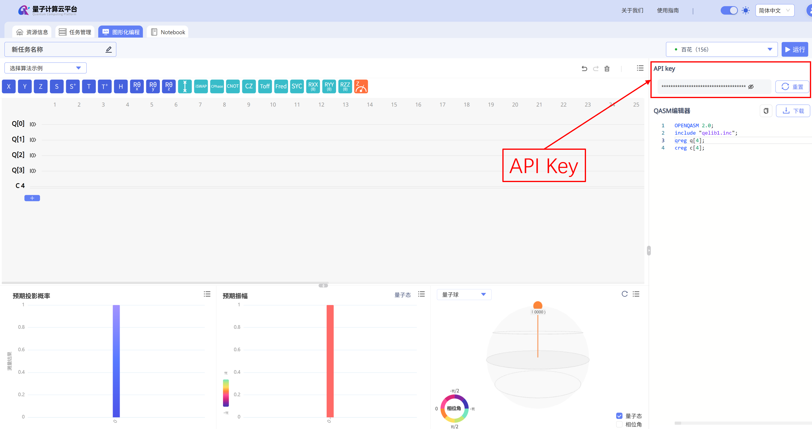

## 1. 简介

`gjq-client` 是国基量子云平台的 Python 客户端工具，致力于为用户提供高效、便捷的量子线路构建、转译、任务提交与结果获取能力。无论是量子计算初学者，还是从事科研与工程开发的专业人员，都可以借助 `gjq-client` 快速接入云端量子资源，开展量子算法的设计、验证与实验。
除 Qiskit 工作流外，`gjq-client 0.2.1` 还提供 Session 独占资源执行、MPS 千比特模拟、PennyLane 可选集成，以及基于 PQC Gateway 的后量子密码加密通信。本教程将系统介绍安装与认证、后端选择、线路转译、Sampler/Estimator、MPS、Session、PennyLane、PQC 加密通道和任务查询。
平台和 `gjq-client` 接入了以下计算资源（后端是否在线、排队数量和支持的任务模式会变化，请以 `service.list_backends()` 的实时结果为准）：

- 全振幅模拟器：九霄`FAS-CPU`(20)、七律`FAS-GPU`(32)

- 单振幅模拟器：九缘`SAS-CPU`(200)、七曜`SAS-GPU`(32)

- 张量网络模拟器：七绎`MPS`(1000)

- 量子真机：百花`Baihua`(156)、国基八号`Guoji08`(20)

## 2. 安装与认证

### 2.1 安装

`gjq-client 0.2.1` 要求 Python 3.12 或更高版本，并使用 Qiskit 2.3。建议先创建独立虚拟环境，避免项目依赖与系统 Python 中的其他包冲突：

```powershell
python -m venv .venv
.\.venv\Scripts\Activate.ps1
python -m pip install --upgrade pip
python -m pip install gjq-client
```

基础安装会自动安装 `requests`、Qiskit、`qiskit-ibm-runtime` 和 PQC 通信所需的 `cryptography`。如需使用 PennyLane，再安装可选依赖：

```powershell
python -m pip install "gjq-client[pennylane]"
```

GitHub 仓库提供公开的 SDK 源码供参考。实际使用请安装 PyPI 发行包，发行包包含连接云平台所需的编译组件。此源码目录不支持独立安装或运行。

### 2.2 API Key 与账号缓存

登录[国基量子云平台](https://tiangongqs.com/cloud/circuit)获取 API Key：



推荐通过环境变量传入密钥，避免把密钥写进源码：

```powershell
$env:GJQ_API_KEY = "your_api_key"
```

```python
import os
from gjq_client import GJQRuntimeService

# 首次运行时从环境变量读取 API Key。初始化成功后，账号配置会写入本地缓存。
service = GJQRuntimeService(api_key=os.environ["GJQ_API_KEY"])

# list_backends() 会打印后端表格，同时返回后端信息字典列表。
backends = service.list_backends()
```

后续运行可以直接复用本地账号缓存：

```python
from gjq_client import GJQRuntimeService

service = GJQRuntimeService()
```

首次提供 API Key 后，SDK 会把账号参数写入：

- Windows：`%USERPROFILE%\.gjq_client\gjq_client_account.json`

- Linux/macOS：`~/.gjq_client/gjq_client_account.json`

**安全建议**：

- 切勿将包含 `api_key` 的配置文件上传到公共代码仓库。

- 建议为 CLI 或自动化环境创建仅限于所需权限的 API Key，并按需定期轮换。

## 3. 设备发现与状态

`list_backends()` 会打印并返回当前可用后端设备，返回项中常用字段包括 `name`、`type`、`max_qubits`、`available_qubits`、`num_of_pending_tasks` 和 `job_mode`。`job_mode` 包括 Job（传统单任务）模式和 Session（会话式执行）模式两种。

```python
from gjq_client import GJQRuntimeService

# 该代码片段只提供查询功能，不建议写在生产代码中
service = GJQRuntimeService()  # 已完成首次账号配置
available = service.list_backends() # 会打印如下的设备表格

# 示例输入如下，请以实时结果为准：
# Available backends (7):
# Name    | Type            | Max qubits | Available qubits | Pending tasks | Job modes   
# --------+-----------------+------------+------------------+---------------+-------------
# FAS-CPU | CPU Simulator   | 20         | 20               | 51            | job         
# SAS-CPU | CPU Simulator   | 200        | 200              | 2             | job         
# FAS-GPU | GPU Simulator   | 32         | 32               | 5             | job         
# SAS-GPU | GPU Simulator   | 32         | 32               | 1             | job         
# Baihua  | Superconducting | 156        | 154              | 0             | job         
# Guoji08 | Superconducting | 20         | 20               | 152           | job, session
# MPS     | GPU Simulator   | 1000       | 1000             | 50            | job       

backend = service.backend("Baihua")

# basis_gates 用于查看原生门集，coupling_map 用于查看双比特门连接约束。
print(backend.configuration().basis_gates)
print(backend.configuration().coupling_map)
```

注意：

- `service.backend(name)` 只接受当前可用的后端名称。

- `service.least_busy()` 从全部可用后端中选择排队最少的一项，结果可能是模拟器，不保证是真机。

- `configuration().coupling_map` 会综合顶层配置和各量子门的连通约束。

- 真机属性来自远端校准服务；某些设备（如模拟器）可能暂时不提供频率或门误差。

## 4. 构建与转译线路

建议始终根据目标后端转译线路。`optimization_level` 支持 `0`、`1`、`2`、`3`，默认值为 `2`；值越高，优化通常越积极。`None` 返回空的 PassManager，线路不会被转换到目标后端门集，只有在原线路已经满足后端约束时才应使用。

```python
from qiskit import QuantumCircuit
from gjq_client import GJQRuntimeService, generate_preset_pass_manager

service = GJQRuntimeService()
backend = service.backend("FAS-CPU")

# 创建 Bell 态：理论上测量结果主要分布在 00 和 11。
circuit = QuantumCircuit(2)
circuit.h(0)
circuit.cx(0, 1)
circuit.measure_all()

# optimization_level=2 在编译耗时与线路优化程度之间取折中。
# （可选）固定 seed_transpiler 可提高多次转译结果的可复现性。
pass_manager = generate_preset_pass_manager(
    backend=backend,
    optimization_level=2,
    seed_transpiler=42,
)
isa_circuit = pass_manager.run(circuit)

print("转译前线路深度：", circuit.depth())
print("转译后线路深度：", isa_circuit.depth())
```

自定义门处理规则：

- 后端声明的原生门会保留。

- 带有定义的自定义门会在提交前递归分解，原始线路不会被修改。

- 没有定义且不是后端原生操作的不透明门会在提交前被拒绝。

## 5. 提交任务

### 5.1 Sampler

Sampler 返回测量计数，输入线路必须包含至少一个 `measure` 操作。

```python
from qiskit import QuantumCircuit
from gjq_client import GJQRuntimeService, Sampler, generate_preset_pass_manager

service = GJQRuntimeService()
backend = service.backend("FAS-CPU")

# 构造两比特 Bell 态并测量全部量子比特。
circuit = QuantumCircuit(2)
circuit.h(0)
circuit.cx(0, 1)
circuit.measure_all()

# 提交前按目标后端的门集与连接关系完成转译。
isa_circuit = generate_preset_pass_manager(
    backend=backend,
    optimization_level=2,
).run(circuit)

# shots 表示重复采样次数；次数越多，统计分布通常越稳定。
job = Sampler(backend=backend).run(isa_circuit, shots=1024)

# result() 会轮询任务状态，timeout 仅限制客户端等待时间。
result = job.result(timeout=300)
counts = result["counts"]
print("测量计数：", counts)
print("实际采样总数：", sum(counts.values()))
```

`counts` 的键是经典比特串，值是对应结果出现的次数；各项之和通常等于 `shots`。`RuntimeJob.result()` 会等待任务进入终态。对于真机任务，由于排队和结果写入需要时间，SDK 会自动轮询，用户无需自行编写循环。

#### SAS 单振幅后端

`SAS-CPU` 和 `SAS-GPU` 每次任务必须提供且只提供一个合法的 `amplitude_index`，范围为 `0 <= index < 2**n_qubits`。

```python
backend = service.backend("SAS-CPU")
isa_circuit = generate_preset_pass_manager(backend=backend).run(circuit)
job = Sampler(backend=backend).run(
    isa_circuit,
    shots=1024,
    amplitude_index=[0],  # 查询 |00...0> 对应的单个计算基态振幅
)
result = job.result(timeout=300)
```

SAS 返回的是指定计算基态的单振幅信息，不应把它当成完整分布来计算一般期望值。

### 5.2 Estimator

Estimator 用于计算量子态的观测量期望值。下面使用国基八号 `Guoji08` 执行。其高层接口 `Estimator.run()` 接受未测量或部分测量的输入线路，并自动补齐末端测量范围，不修改调用者的原线路。

```python
from qiskit import QuantumCircuit
from qiskit.quantum_info import SparsePauliOp
from gjq_client import Estimator, generate_preset_pass_manager

backend = service.backend("Guoji08")
circuit = QuantumCircuit(1)
circuit.h(0)

observable = SparsePauliOp("X")
isa_circuit = generate_preset_pass_manager(backend=backend).run(circuit)

result = Estimator(backend=backend).run(
    isa_circuit,
    observable=observable,
    shots=1024,
).result(timeout=300)
print(result["evs"])
```

使用字符串形式的观测量时，量子比特索引按已提交线路的物理量子比特解释，不会做逻辑布局映射；如需自动逻辑布局映射，推荐用 `SparsePauliOp`。

Guoji08 支持有限实数系数、多比特 X/Y/Z Pauli 观测量、恒等项和具名 Hamiltonian 求和。多项 `SparsePauliOp` 作为一个整体返回到 `result["evs"]["observable"]`；显式具名观测量列表则按调用者提供的名称分别返回期望值。Guoji08 的 `shots` 必须为正整数；只有 MPS Estimator 可以使用 `shots=0`。

### 5.3 MPS 模拟器

MPS 支持 2 至 1000 个量子比特，但实际可运行规模取决于线路深度和纠缠程度。每次任务都必须提供 `options["simulator_config"]`。

#### 5.3.1 预设与配置参数

`fast`、`balanced` 和 `accurate` 是内置预设。使用这三个预设时，用户只能选择预设名称和 GPU 数量，不能同时覆盖 `dtype`、`mps` 或 `svd`；如需调整这些参数，应使用 `expert`。

| 预设         | 数据类型         | 最大键维度 | 截断参数                                      | SVD                           | 适用场景        |
| ---------- | ------------ | ----: | ----------------------------------------- | ----------------------------- | ----------- |
| `fast`     | `complex64`  |    64 | `abs=1e-8`、`rel=1e-8`、`discarded=1e-10`   | `gesvd`                       | 优先速度和较低显存占用 |
| `balanced` | `complex128` |   128 | `abs=1e-10`、`rel=1e-10`、`discarded=1e-12` | `gesvd`                       | 速度与精度折中     |
| `accurate` | `complex128` |   512 | `abs=1e-12`、`rel=1e-12`、`discarded=1e-14` | `gesvdj`，容差 `1e-12`，最多 80 次扫描 | 优先精度        |
| `expert`   | 用户配置         |  用户配置 | 用户配置                                      | 用户配置                          | 需要显式控制数值参数  |

简单预设的配置结构必须只有 `preset` 和 `runtime`：

```python
options = {
    "simulator_config": {
        "preset": "fast",  # 也可以是 balanced 或 accurate
        "runtime": {"num_gpus": 1},
    }
}
```

`expert` 必须完整提供以下字段，不能遗漏或增加未定义字段：

| 参数                            | 允许值或范围                    | 说明                        |
| ----------------------------- | ------------------------- | ------------------------- |
| `dtype`                       | `complex64`、`complex128`  | 状态张量的数据精度                 |
| `runtime.num_gpus`            | 整数 1 至 2                  | 使用的 GPU 数量                |
| `mps.max_bond_dimension`      | 整数 2 至 4096               | MPS 最大键维度；越大通常精度越高、资源消耗越大 |
| `mps.abs_cutoff`              | `1e-18` 至 `1e-2`          | 奇异值绝对截断阈值                 |
| `mps.rel_cutoff`              | `1e-18` 至 `1e-2`          | 奇异值相对截断阈值                 |
| `mps.discarded_weight_cutoff` | `1e-18` 至 `1e-4`          | 舍弃权重阈值                    |
| `svd.algorithm`               | `gesvd`、`gesvdp`、`gesvdj` | SVD 算法                    |
| `svd.gesvdj_tol`              | `0`，或 `1e-18` 至 `1e-2`    | 仅 `gesvdj` 使用，并且必须提供      |
| `svd.gesvdj_max_sweeps`       | 整数 1 至 200                | 仅 `gesvdj` 使用，并且必须提供      |

完整的 `expert` 示例：

```python
expert_options = {
    "simulator_config": {
        "preset": "expert",
        "dtype": "complex128",
        "mps": {
            "max_bond_dimension": 256,
            "abs_cutoff": 1e-10,
            "rel_cutoff": 1e-10,
            "discarded_weight_cutoff": 1e-12,
        },
        "svd": {
            "algorithm": "gesvdj",
            "gesvdj_tol": 1e-12,
            "gesvdj_max_sweeps": 80,
        },
        "runtime": {"num_gpus": 1},
    }
}
```

选择 `gesvd` 或 `gesvdp` 时，`svd` 中只能保留 `algorithm`；`gesvdj_tol` 和 `gesvdj_max_sweeps` 仅能与 `gesvdj` 一起使用。

#### 5.3.2 Sampler 示例：获取采样分布

下面第一段示例使用 MPS Sampler，线路必须包含测量门。`counts` 是稳定返回字段；当服务端返回概率型结果、SDK据此恢复整数 shots 时，还会保留可选的 `probabilities` 字段。服务端直接返回整数计数时，该字段可能不存在。

```python
from qiskit import QuantumCircuit
from gjq_client import GJQRuntimeService, Sampler

service = GJQRuntimeService()
backend = service.backend("MPS")

circuit = QuantumCircuit(10)
circuit.h(0)
# 通过相邻 CNOT 构造 10 比特 GHZ 态。
for qubit in range(9):
    circuit.cx(qubit, qubit + 1)
circuit.measure_all()

options = {
    "simulator_config": {
        "preset": "fast",            # 优先速度和较低显存占用
        "runtime": {"num_gpus": 1}, # 当前任务使用 1 张 GPU
    }
}

result = Sampler(backend=backend, options=options).run(
    circuit,
    shots=1024,
).result(timeout=300)
print("采样计数：", result["counts"])
```

#### 5.3.3 Estimator 示例：获取期望值

MPS Sampler 的 `shots` 必须为正整数。MPS Estimator 可使用 `shots=0`；PennyLane QNode 仍需正整数有限 shots。

下面第二段示例使用 MPS Estimator。它直接从模拟状态计算期望值，不需要测量门；`backend` 和 `options` 复用上一段示例。MPS Estimator 支持有限实数系数、多比特 Pauli 字、恒等项和 Hamiltonian 求和。多项 `SparsePauliOp` 作为一个整体观测量提交，聚合结果使用 `observable` 名称。

```python
from qiskit import QuantumCircuit
from qiskit.quantum_info import SparsePauliOp
from gjq_client import Estimator

bell = QuantumCircuit(2)
bell.h(0)
bell.cx(0, 1)

# MPS Estimator 直接从模拟状态计算期望值，因此线路无需添加测量门。
hamiltonian = SparsePauliOp.from_list([("ZZ", 0.5), ("XI", 0.8)])
result = Estimator(backend=backend, options=options).run(
    bell,
    observable=hamiltonian,
    shots=0,           # 状态模拟不进行有限次数采样
).result(timeout=300)
print("Hamiltonian：", result["evs"]["observable"])
```

## 6. Session

只有 `job_mode` 包含 `session` 的后端才能创建 Session。目前只有 `Guoji08` 支持 `job` 和 `session`，以实时结果为准。`max_time` 的有效范围是 60 至 28800 秒。
Session 适合连续执行多个相关任务：在有效期内，多个任务共享同一 `session_id` 并复用同一独占后端资源，避免每个任务分别申请资源。下面的示例在一个 Session 中连续提交两条线路，最后统一查看 Session 状态和关联任务。

```python
from qiskit import QuantumCircuit
from gjq_client import GJQRuntimeService, Sampler, Session, generate_preset_pass_manager

service = GJQRuntimeService()
backend = service.backend("Guoji08")

bell = QuantumCircuit(2)
bell.h(0)
bell.cx(0, 1)
bell.measure_all()

inverted_bell = QuantumCircuit(2)
inverted_bell.x(0)
inverted_bell.h(0)
inverted_bell.cx(0, 1)
inverted_bell.measure_all()

pass_manager = generate_preset_pass_manager(backend=backend)
isa_circuits = [pass_manager.run(circuit) for circuit in (bell, inverted_bell)]

# 直接创建 Session，由程序决定何时释放资源。
session = Session(backend=backend, max_time=3600)
print(f"Session 创建成功，Session ID：{session.session_id}")
session_id = session.session_id

sampler = Sampler(mode=session)
jobs = [sampler.run(circuit, shots=256) for circuit in isa_circuits]

for index, job in enumerate(jobs, start=1):
    print(f"任务 {index} 计数：", job.result(timeout=600)["counts"])

print(f"Session {session_id} 当前状态：", session.status)
print(f"Session {session_id} 已提交任务：", session.tasks())

# 上述代码结束后 Session 仍可继续接收任务；确认不再使用时再关闭。
session.close()
```

两个任务的提交载荷都会携带同一 `session_id`。如果需要在其他代码中继续查询，应同时保存 Session ID 和后端名称；按 ID 查找当前活动 Session 的方法见第 7 节。

直接实例化后，普通代码块或函数执行结束不会触发自动关闭；Session 会保持可用，直到调用 `close()`、`cancel()` 或达到 `max_time`。如果只需要在固定代码范围内使用，也可以采用 `with Session(...) as session`，退出该范围时 SDK 会自动关闭 Session。不支持 Session 的后端会在创建阶段明确拒绝。

## 7. 查询任务

### 7.1 查询独立任务

```python
from gjq_client import GJQRuntimeService
from qiskit.quantum_info import SparsePauliOp

service = GJQRuntimeService()
# 获取用户所有活跃任务列表
tasks = service.list_tasks()
print("当前用户所有活跃任务列表：", tasks)

# 替换your_task_id以获取某个任务的状态
task_id = "your_task_id"
status = service.task_status(task_id)
print(f"任务{task_id}的状态：{status}") 

# Sampler：查询counts
counts = service.task_result(task_id)
print(f"任务{task_id}的采样计数：{counts}")

# Estimator：查询观测量
observable = SparsePauliOp("IZ")
evs = service.task_result(task_id, observable=observable)
print(f"任务{task_id}的期望值：{evs}")
```

`service.task_status()` 返回状态字符串，而不是包含 `status` 的字典；`service.task_result()` 返回精简后的 counts 或 evs。需要完整响应元数据时，应保留提交任务时获得的 `RuntimeJob` 并调用 `job.result()`。

### 7.2 查询 Session 及其任务

`list_sessions()` 返回当前账号下尚未关闭的 Session。只有 Session ID 时，可以先从该列表定位目标记录并取得其后端名称，再分别读取会话详情和关联任务：

```python
from gjq_client import GJQRuntimeService

service = GJQRuntimeService()
session_id = "your_session_id"

active_sessions = service.list_sessions()
target = next(
    (item for item in active_sessions if item.get("session_id") == session_id),
    None,
)

if target is None:
    print(f"当前活动 Session 中未找到 {session_id}")
else:
    backend_name = target["backend_name"]
    detail = service.session_detail(session_id, backend_name)
    related_tasks = service.session_tasks(session_id, backend_name)

    print("Session 详情：", detail)
    print("Session 关联任务：", related_tasks)
```

上述查询不会重新创建 Session，也不会改变其状态。`list_sessions()` 只包含 `pending` 和 `active` 状态；查询已经关闭或取消的 Session 时，需要使用创建阶段保存的 `backend_name`，直接调用 `session_detail()` 或 `session_tasks()`。

## 8. PennyLane 集成

PennyLane 适合编写参数化量子线路、自动微分和变分算法。使用前需安装可选依赖 `pip install "gjq-client[pennylane]"`。下面示例在可用的 FAS 后端或量子真机上创建 `gjq` 设备，并通过参数偏移法计算梯度：

```python
import pennylane as qml
from pennylane import numpy as np
from gjq_client import GJQRuntimeService

service = GJQRuntimeService()
backend = service.backend("FAS-CPU")

# wires 指定 QNode 可使用的量子比特数；timeout 是单次云任务的等待上限。
device = qml.device("gjq", wires=2, backend=backend, timeout=300)

# 有限 shots 会把 QNode 作为真实云任务执行，而不是本地解析模拟。
@qml.set_shots(1024)
@qml.qnode(device, diff_method="parameter-shift")
def circuit(theta):
    qml.RY(theta, wires=0)
    qml.CNOT(wires=[0, 1])
    return qml.expval(qml.Z(1))

# requires_grad=True 表示该参数需要参与自动微分。
# 梯度计算需要提交多次云任务，并在云平台单独显示。
theta = np.array(0.5, requires_grad=True)
print("期望值：", circuit(theta))
print("梯度：", qml.grad(circuit)(theta))
```

PennyLane 设备支持 `expval`、`var`、`probs`、`sample` 和 `counts`。梯度计算可能需要提交多次云任务，应为排队和执行预留足够时间。`SAS-CPU` 和 `SAS-GPU` 仅返回单振幅，不支持 PennyLane 设备。

计算基测量的 `counts`、`sample` 和 `probs` 遵循每个测量显式指定的 `wires` 顺序。例如 `wires=[0, 1]` 的计数键最左侧对应 wire 0。Runtime 原始计数仍遵循 Qiskit 小端序约定。

在 MPS 上运行同一 QNode 时，只需替换设备配置：

```python
device = qml.device(
    "gjq",
    wires=2,
    backend=service.backend("MPS"),
    options={
        "simulator_config": {
            "preset": "fast",
            "runtime": {"num_gpus": 1},
        }
    },
    timeout=300,
)
```

MPS 上的 PennyLane 期望值和方差支持有限实数系数、多比特 Pauli 乘积、恒等常数和 Hamiltonian 求和。Pauli 求和仍仅用于 `expval` 和 `var`；采样类测量应针对基态或单个 Pauli 观测量。

## 9. PQC 后量子密码加密通道

当业务需要为 SDK 与云平台之间的 API 通信增加抗量子攻击的应用层保护时，可以启用 PQC 模式。启用后，认证、查询后端、提交任务和获取结果等调用方式保持不变，SDK 会把请求通过 PQC Gateway 的加密代理通道传输。
使用前需要满足以下条件：

- 已部署并可访问与当前云平台环境匹配的 PQC Gateway；

- 安装环境中的 `cryptography` 版本满足项目要求（基础安装会自动安装）。

```python
import os
from gjq_client import GJQRuntimeService

service = GJQRuntimeService(
    api_key=os.environ["GJQ_API_KEY"],
    pqc=True
)

# PQC 只改变底层传输路径，上层 SDK 调用方式与普通模式相同。
backends = service.list_backends()
backend = service.backend("FAS-CPU")
print("已通过 PQC 通道获取后端：", backend.name)
```

首次使用 API Key 初始化成功后，PQC 开关和证书指纹会随账号参数写入本地缓存；后续直接调用 `GJQRuntimeService()` 时会复用该配置。
SDK 通过 Gateway 加密 API 通信，并校验服务端证书指纹。PQC 模式不会改变量子线路、后端能力、任务语义或结果格式。

常见排查方法：

- 初始化阶段连接失败：确认 Gateway 已启动，并且客户端能够访问其配置地址；

- 提示证书指纹不匹配：停止连接并联系[平台支持](mailto:quantumcloud@tgqs.net)重新核对指纹，保持证书校验开启；

- 普通模式可用、PQC 模式不可用：联系平台支持，确认 Gateway 的配置与可用状态。

## 10. 常见问题

- 首次运行必须传入 API Key；缓存文件缺失时直接调用 `GJQRuntimeService()` 会抛出 `ConfigurationError`。

- Sampler 和 FAS/SAS Estimator 的线路必须包含测量门。Guoji08 的 `Estimator.run()` 会自动补齐末端测量范围；MPS Estimator 无需测量门。

- MPS 至少需要 2 个量子比特，并且必须提供 `simulator_config`。

- SAS 必须提供一个合法的 `amplitude_index`。

- FAS/SAS Estimator 不允许 X/Y；真机返回服务端 `evs` 时允许 X/Y。

- 真机后端配置、属性和可用性来自远端服务。遇到瞬时错误时可稍后重试。

- PennyLane 自动微分可能触发多次云任务；请根据线路规模、shots 和后端排队情况设置合理的 `timeout`。

- PQC 模式依赖可访问的 Gateway 和正确的服务端证书指纹；它不会改变后端是否在线或任务排队时间。

## 联系方式

- 电子邮箱：<quantumcloud@tgqs.net>

- 问题反馈：[Submit an issue](https://github.com/guoji-quantum/gjq_client/issues/new)
